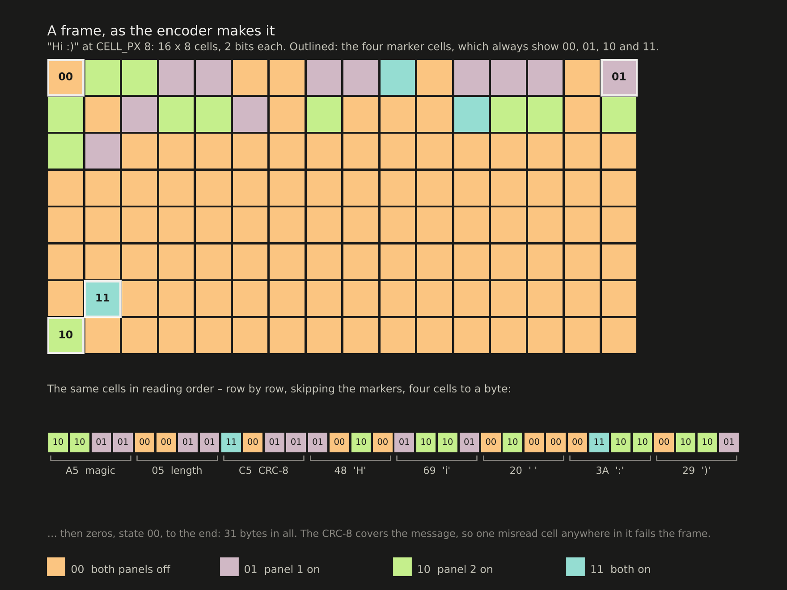
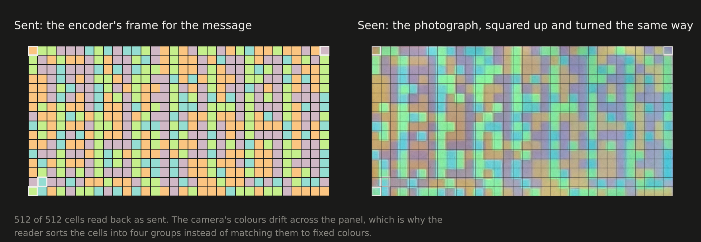
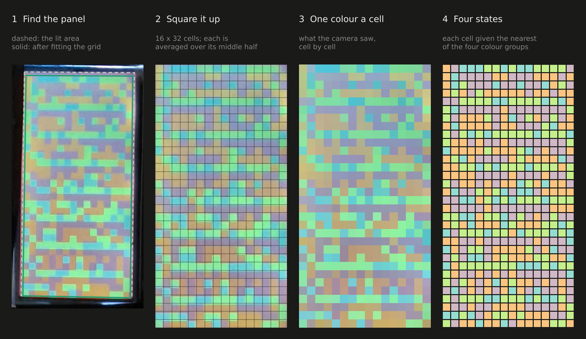
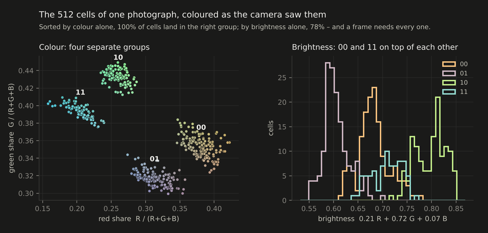
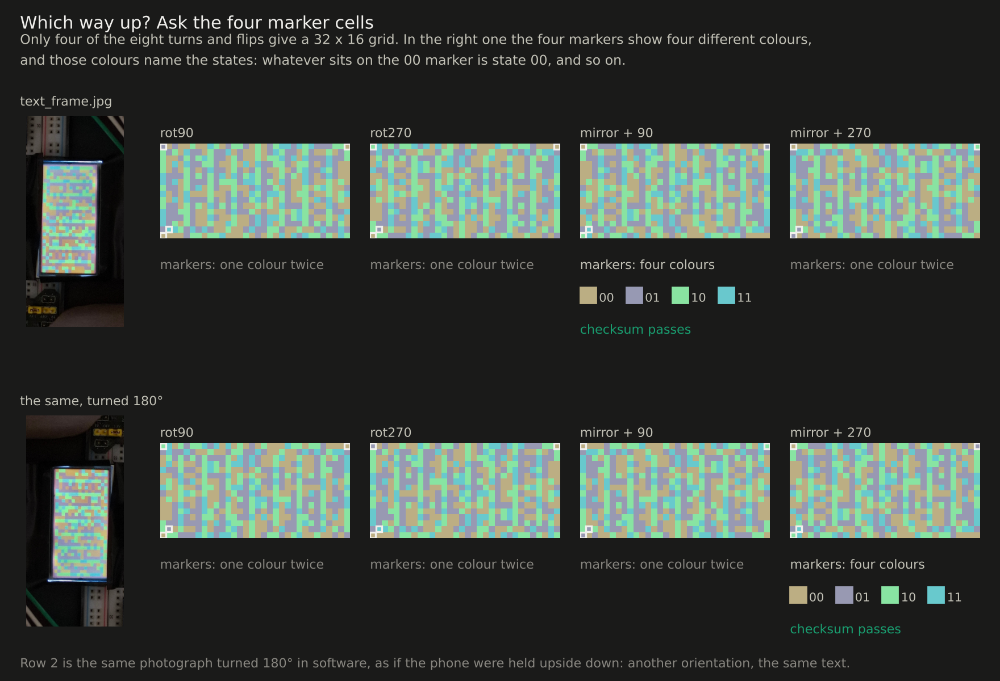
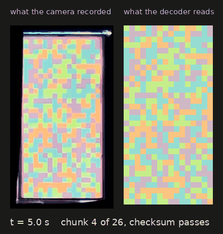
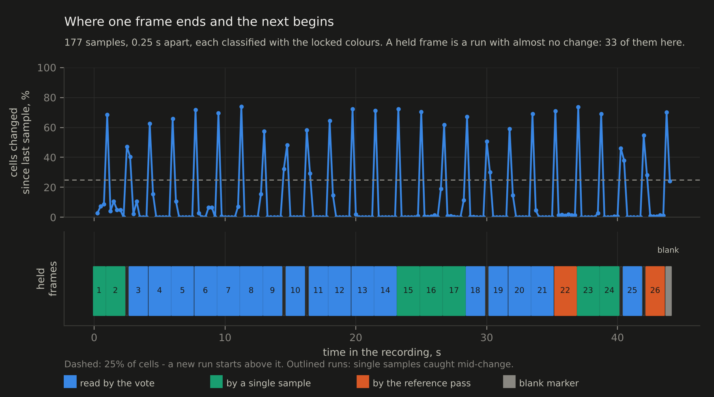
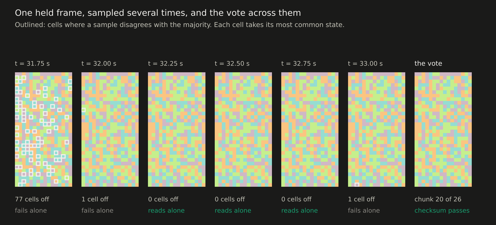
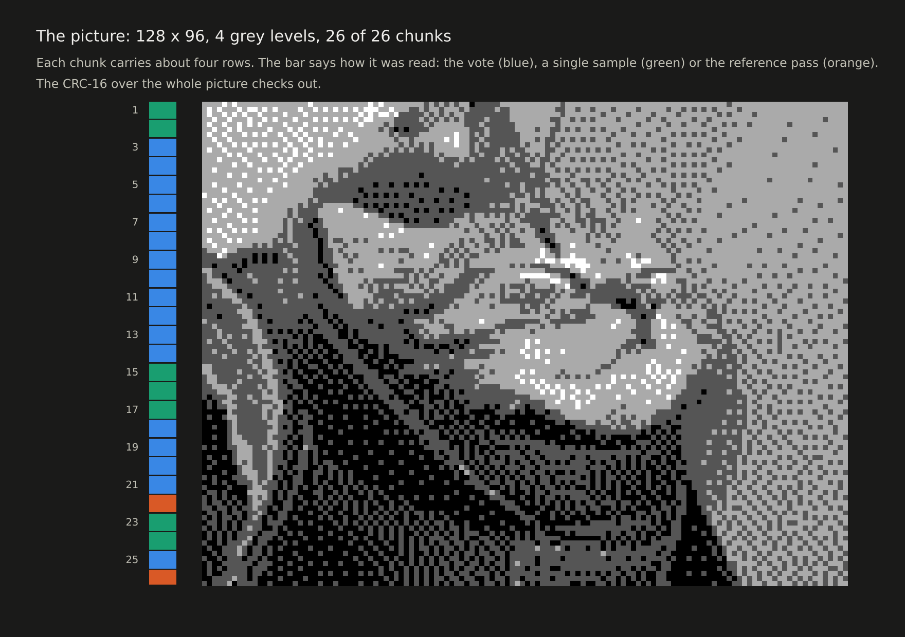

# How decoding works

Two real examples, followed through the decoder step by step:

- **a text frame**, photographed with a phone — [`examples/text/`](examples/text/)
- **a picture sent as 26 frames**, filmed in one 44-second recording — [`examples/video/`](examples/video/)

Every figure on this page is drawn from those files by
[`make_decoding_figures.py`](make_decoding_figures.py), which runs the decoder
from the Colab notebook unchanged, so the figures show what the notebook
actually does. Frames generated by the encoder appear where the clean version is
easier to read than a photograph.

---

## What the panel shows



A frame is the panel's grid of cells, each in one of four states — two bits a
cell. The encoder writes a three-byte header (the magic byte `A5`, the length,
and a CRC-8 of the message), then the message, then zeros to the end.

Four cells are reserved as **markers**, always showing `00`, `01`, `10` and `11`:
three of the corners, plus the cell diagonally inside the bottom-left one. The
fourth corner is left empty, which makes the pattern lopsided: no turn or flip of
the frame looks like any other. That is what lets the reader work out which way
up a photograph is, and, as it turns out, which colour is which state.

The examples use `CELL_PX 4`: 32 × 16 = 512 cells, 508 after the markers, so 127
bytes — up to 124 characters of text in one frame.

---

## Reading one photograph

The text example is one frame carrying this message, 123 characters:

> Hi, I am Mariusz and this is my data transfer project. It can hold 127 bytes per frame. It is not perfect, but it works! :)



### Find the panel, square it up, read the cells



1. **Find the panel.** The lit area against the dark background gives four
   corners. Its edge is not quite the edge of the cells — the glass has a border,
   and the outermost cells are dimmer — and over 32 cells a small error grows to
   half a cell at the far end. So the decoder shifts and stretches the grid by
   fractions of a cell, 625 combinations, ranks them by how uniform the cells come
   out, and lets the checksum pick among the best.
2. **Square it up.** A perspective transform maps the quadrilateral onto a
   rectangle, so a phone held at an angle does not matter.
3. **One colour a cell.** Each cell is averaged over its middle half, away from
   the edges where the neighbours bleed in.
4. **Four states.** The 512 colours are sorted into four groups by k-means, with
   and without first dividing out the backlight's gradient, and every cell takes
   the state of its group.

### Four colours, not four brightnesses



The groups are found by colour. In this photograph `00` and `11` are almost
equally bright, and sorting by brightness alone puts only 78% of the cells in the
right group, against 100% by colour. A frame needs every one of its 512, because
a single wrong cell fails the checksum. Why the information lives in the colour
is the subject of [The optics](README.md#the-optics).

### Which way up: the four marker cells



k-means returns four groups but not their names, and the photograph could have
been taken any way round. The markers settle both at once.

Of the eight ways to turn or flip the grid, only four give a 32 × 16 frame. For
each, the decoder looks at the four marker cells. A wrong orientation puts
ordinary cells there, which usually repeat a colour. The right one shows four
different colours, and they *name* the states: whatever colour sits on the `00`
marker is state `00`, and so on. That leaves one reading to check instead of
4 × 24 = 96, and the checksum confirms it.

The second row is the same photograph turned 180° in software, as if the phone
had been held upside down. It reads as mirror + 270 instead of mirror + 90 and
gives the same text. Both need the mirror — the panel shows the frame mirrored
as seen from the camera — and the decoder never has to be told.

If a marker cell is itself misread (they sit in the corners, where the light is
worst), the decoder falls back to trying all 96 readings and lets the checksum
decide alone.

### Bits, bytes, checksum

Read in order, two bits a cell, the 508 data cells give 127 bytes:

```
A5 7B 7E 48 69 2C 20 49 20 61 6D 20 ...
magic A5    length 7B = 123    CRC-8 7E    then "Hi, I am ..."

CRC-8 of the 123 message bytes = 7E   ->  matches, the frame is accepted
```

One misread cell anywhere in the message changes the CRC, and the frame is
rejected rather than misread.

---

## Reading a recording



The recording is 44 seconds of the panel cycling through the 26 frames of a
picture, each held for 1.5 s, with a blank frame between cycles. As far as the
header is concerned a picture frame is an ordinary frame; inside, it carries its
chunk number, the total, and a CRC-16 of its own (see [Protocol](README.md#protocol)).

### Lock on once

The decoder samples the video every 0.25 s, 177 samples. It does not search them
all: it ranks a handful by how cleanly their cells fall into four colours, and
runs the photograph search above on the best until one decodes. Here the first
one did, the sample at 19.2 s, with the markers naming the orientation and the
colours. That fixes the geometry, the orientation and the four colours — the
*lock* — and every other sample is then classified against it in milliseconds.

### Where one frame ends and the next begins



Comparing the images would not show where the frames change: on a handheld
recording, shake and compression make two samples of one frame differ about as
much as two different frames. Comparing the classified cells does. Inside a held
frame typically not one cell changes from one sample to the next; where a new
frame starts, about two thirds of them do. A new run starts wherever more than a
quarter change: 33 runs here, which are the 26 frames, the blank marker, and six
single samples caught halfway through a change.

### A vote across the samples



Each held frame was sampled about six times, 0.25 s apart. Rather than hope
one sample is perfect, the decoder first takes a per-cell majority vote
across them, which outvotes a sample caught mid-update or hit by noise. In the
frame above, three of the six samples read on their own and three do not — one
caught mid-change with 77 cells wrong, two with a single wrong cell each — and
the vote reads it.

The vote is not always the better reading, though. It removes errors that come
and go; it cannot remove one that stays. In five of the frames here the same cell
or two at the edge of the panel read wrong in most samples, so the majority was
wrong too, while one or two samples happened to get them right — and in the
first two seconds of the recording, half or more of the samples had dozens of
cells wrong. So when the vote fails, the decoder tries the samples one at a time.
Across this recording the vote read 17 frames, and a single sample 7 more. Errors
that stay put are what the next step is for.

### The reference pass

A frame that decoded says exactly what every one of its cells should look like,
so the decoded frames measure the lighting cell by cell. The decoder builds a
reference colour for each cell and each state from them and re-reads the frames
that failed against it. Here that recovered the last 2 of the 26.

### The picture



Each chunk carries its number and the total, so the order they arrive in does not
matter, and a missing one is known by number. Joined up they give the picture:
128 × 96 pixels, four grey levels, with a CRC-16 over the whole stream that
confirms it end to end.

---

## Try it

Open [`colab/lcd_codec_colab.ipynb`](colab/lcd_codec_colab.ipynb) in Colab, run
**Setup**, then in **3 Decode** set `GRID` to `32x16` and upload
`examples/text/text_frame.jpg` or `examples/video/picture_26_frames.mp4`. The
recording takes a minute or two.

The recording here is a re-encoded copy of the 67 MB original from the phone,
with the sound removed and the frame timing kept exactly. It is 25 MB and still
decodes completely, but only just: re-encoded to 16 MB, it no longer gets all 26
chunks. That is the same cliff as in
[Frame rate](README.md#frame-rate-and-why-it-is-the-hard-limit) — 512 cells a
frame, and a single wrong one fails the chunk.

To redraw every figure on this page:

```bash
pip install numpy pillow matplotlib opencv-python
python make_decoding_figures.py
```
