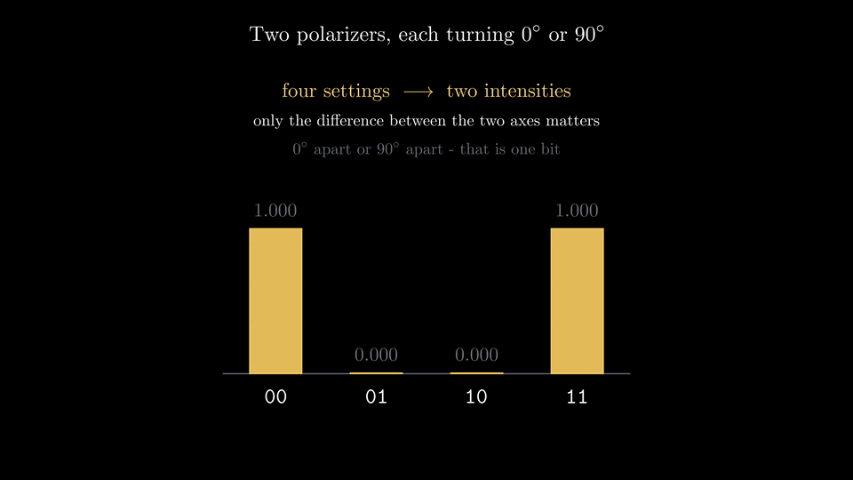
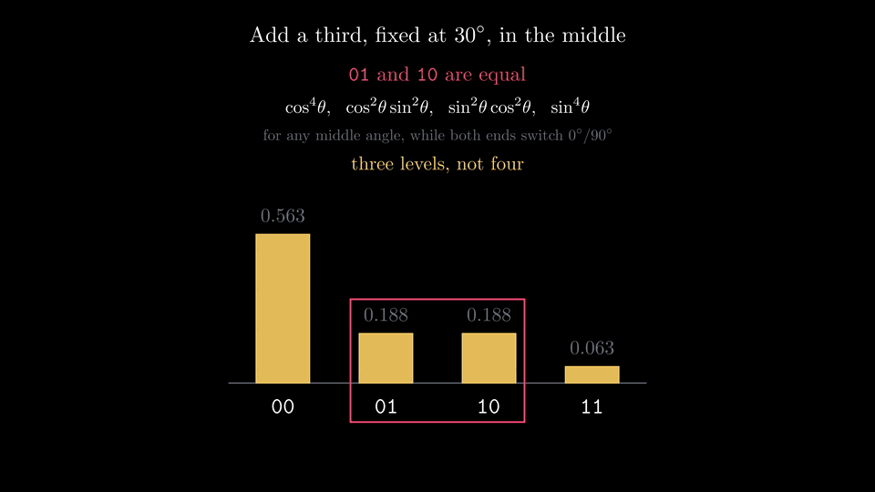
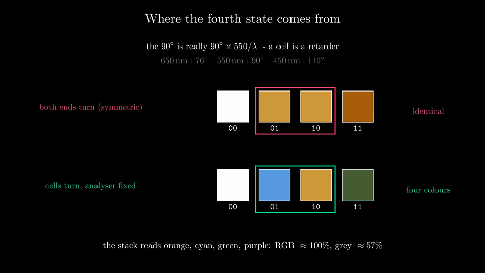
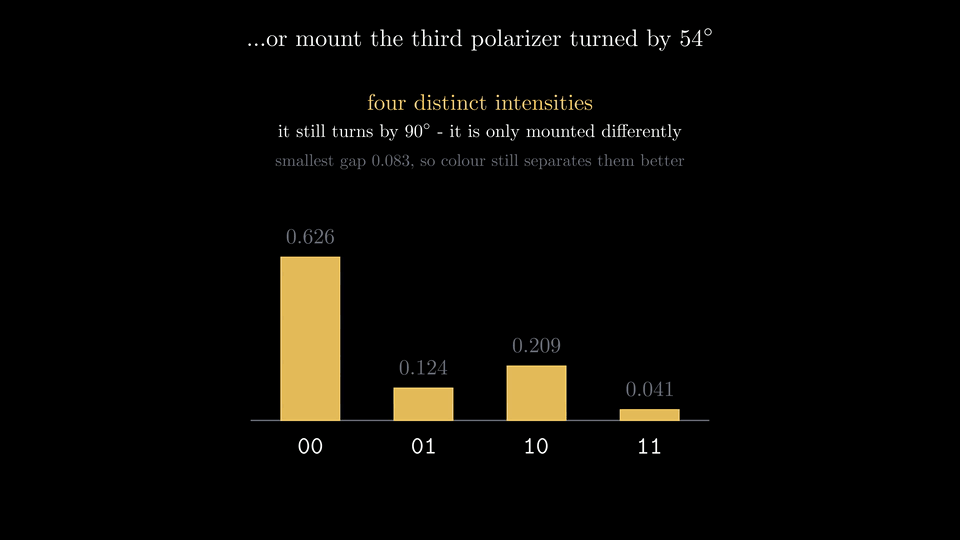
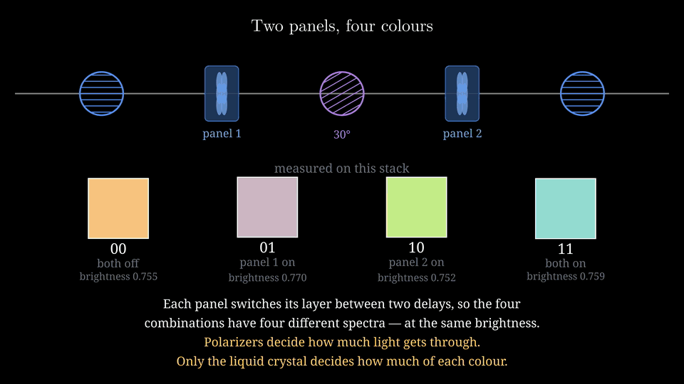
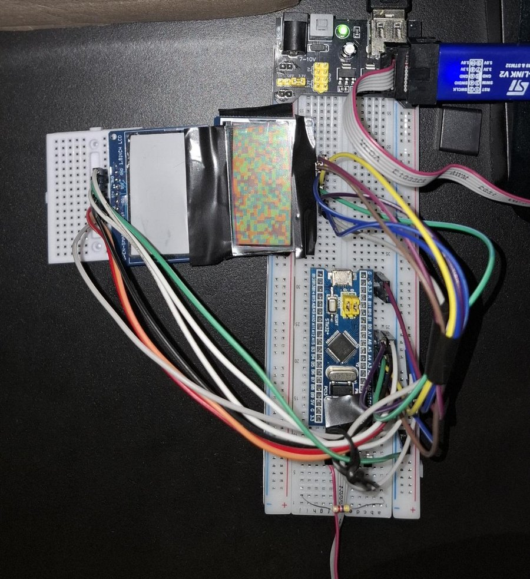
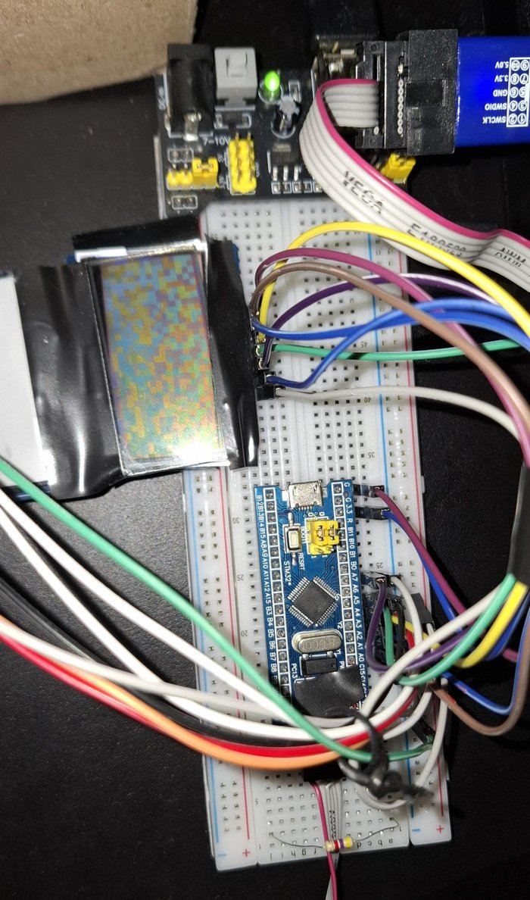
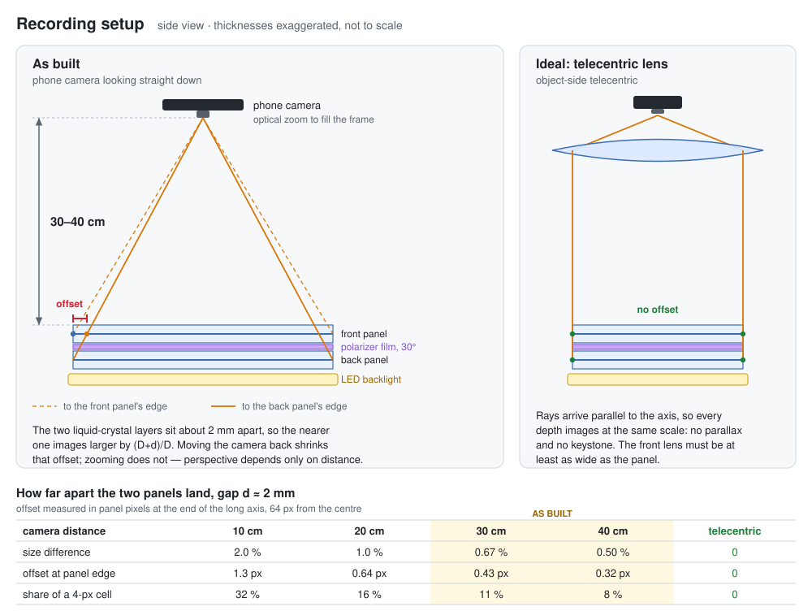

# Two-Panel LCD Optical Data Link

Sending data as light through two stacked LCD panels, photographed with a phone
and decoded in software.

Two ST7567 128×64 monochrome panels sit one behind the other with their factory
polarizers removed and external polarizers fitted. Each panel cell is an
independent 90° polarization switch, so a cell of the stack has four optical
states — **two bits per cell, one shot of the camera per frame**. An STM32F103C8T6
Blue Pill drives both panels over one SPI bus; a Colab notebook turns a file or a
picture into frames, and turns a photograph or a video of the panels back into
the original bytes, checksum-verified.

---

## How it works

```
  text / image                                     camera
       │                                              │
       ▼                                              ▼
  [ Colab: encode ]                           [ Colab: decode ]
   frame bytes → cells                     locate panel → fit grid
       │                                   classify cells → bytes
       ▼                                              ▲
  [ STM32: display ]  ──── light ────────────────────┘
   two stacked panels, 2 bits per cell
```

The encoder is deliberately the clever half. The firmware knows nothing about
checksums, whitening or picture formats — it displays the cell states it is
handed. Everything that makes the link survive a handheld phone camera lives in
Python, where it can be changed without reflashing.

**[DECODING.md](DECODING.md)** follows a real photograph of a text frame and a
real recording of a 26-frame picture through the decoder, step by step.
**[Related work](#related-work)** lists the published systems closest to this
one, and what is different here.

### The optics

The stack is three polarizers in series. The outer two turn between 0° and 90° —
that is all an LCD cell does — and the middle one is fixed at 30°.

**Without the middle one**, two polarizers that only turn by 90° give four
settings but just **two** intensities, because only the difference between their
axes matters:

| polarizer 1 | polarizer 3 | apart | transmitted |
|---|---|---|---|
| 0° | 0° | 0° | 1.00 |
| 0° | 90° | 90° | 0.00 |
| 90° | 0° | 90° | 0.00 |
| 90° | 90° | 0° | 1.00 |

Four settings collapse to one bit. **Adding the fixed 30° polarizer in the
middle** splits the chain into two independent Malus factors, because the middle
one resets the polarization to its own axis:

| polarizer 1 | polarizer 3 | transmitted | |
|---|---|---|---|
| 0° | 0° | cos²30 · cos²30 | **0.563** |
| 0° | 90° | cos²30 · sin²30 | **0.188** |
| 90° | 0° | sin²30 · cos²30 | **0.188** |
| 90° | 90° | sin²30 · sin²30 | **0.063** |

(1.00 is the light leaving the first polarizer; unpolarized input halves all four
equally.)

That is the step that makes more than two states possible — but as wired here it
gives **three** levels, not four, and changing the middle angle does not help.

The general rule is worth stating properly, because it says exactly what *would*
help. Write θ for the angle between polarizer 1 and the middle, φ for the angle
between the middle and polarizer 3, and let x = cos²θ, y = cos²φ. Each outer
polarizer swings by 90°, so its factor is either x or 1−x, either y or 1−y, and
the four states are:

```
xy        x(1-y)        (1-x)y        (1-x)(1-y)
```

Those are four distinct numbers **unless x = y or x + y = 1**. And when both outer
polarizers switch in the same 0°/90° frame, x + y = 1 is automatic for every
middle angle — with the middle at 30°, θ = 30° and φ = 60°, so x = 0.75 and
y = 0.25. That is why this arrangement is stuck on three levels: it sits exactly
on the degenerate line, and no choice of middle angle moves it off.

The two mixed cases are worth following step by step, because they really are
different in the middle:

```
 0° -> 30° -> 90°   turn 30°, ×0.750 = 0.750   then turn 60°, ×0.250 = 0.1875
90° -> 30° ->  0°   turn 60°, ×0.250 = 0.250   then turn 30°, ×0.750 = 0.1875
```

Between the panels one path carries three times the light of the other — a real
difference you could measure with a probe in the gap. It just does not survive to
the end, because the output is the product of the same two factors in the
opposite order.

**Where the fourth state actually comes from.** Not from brightness at all. The
decoder labels every cell of every frame it decodes, so a successful decode is
also a colour measurement. Averaged over 75 decoded frames, about 9,500 cells per
state, raw camera RGB:

| state | panel 1 | panel 2 | R | G | B | luminance | |
|---|---|---|---|---|---|---|---|
| `00` | off | off | 0.986 | 0.773 | 0.506 | 0.755 | orange |
| `01` | **on** | off | 0.815 | 0.723 | 0.773 | 0.770 | purple |
| `10` | off | **on** | 0.774 | 0.936 | 0.547 | 0.752 | green |
| `11` | **on** | **on** | 0.585 | 0.867 | 0.824 | 0.759 | cyan |

**All four states are equal in brightness to within 2.4%** — the luminance spread
is half the per-cell noise. The entire signal is chromatic, and that is measured,
not modelled:

| | worst-case separation | relative to noise |
|---|---|---|
| RGB | 0.271 | **8.0×** |
| greyscale | 0.0027 | **0.14×** |

Nearest-centroid classification under that noise predicts **0.003% per-cell error
in RGB and 47.3% in greyscale**; the decoder measures about 100% and 57%
accuracy. A greyscale classifier here is not a worse classifier, it is reading a
channel that carries almost no information.

If you ever want four states by brightness alone, **mount the third polarizer
turned by 54°** so it switches 54°/144° instead of 0°/90°. It still turns by 90°,
it is only mounted differently. That moves φ from 60° to 24°, so x + y = 1.59
instead of 1.00, and the levels separate: 0.626 / 0.209 / 0.124 / 0.041, smallest
gap 0.083 — close to the best this geometry allows (0.086, at θ = 57°, φ = 63°).
Always crowded, which is why colour stays the better discriminator.

**[OPTICS.md](OPTICS.md)** carries the full treatment, including a Jones-calculus
model of the twisted-nematic cells, what it explains and where it fails to fit.
`fit_optics.py` reproduces every number above, and the
**[animations](#animations)** below show the whole argument: four short ones on
the polarizers, and a longer fifth on why the liquid crystal can make colour
when polarizers cannot.

---

## Animations

Five Manim animations of the optics above. The previews are reduced GIFs —
click one for the full 4K video.

#### 1 · Two polarizers that only turn by 90°: four settings, two intensities

[](docs/videos/S1_TwoPolarizers.mp4)

#### 2 · A third, fixed at 30° in the middle: three levels, not four

[](docs/videos/S2_MiddlePolarizer.mp4)

#### 3 · The fourth state is a colour, and only an asymmetric stack makes it

[](docs/videos/S3_WhereTheFourthComesFrom.mp4)

#### 4 · Four intensities without colour: mount the third polarizer at 54°

[](docs/videos/S4_MountTheThirdOffAxis.mp4)

#### 5 · Why a liquid crystal makes colour and a polarizer cannot

Malus's law has no wavelength in it, so a polarizer dims every colour equally.
The liquid crystal slows the part of the light polarized along its molecules,
and a fixed delay is a different fraction of a wave for each colour, so each
colour leaves with its own polarization — shown in 3D, then through a
polarizer, then for a driven pixel and for the two panels of this stack.

[](docs/videos/S5_WhyTheLCDMakesColour.mp4)

### Rendering them

All five scenes are in `polarizer_states.py`. With
[Manim Community](https://docs.manim.community/) installed (v0.18 or newer;
LaTeX is optional):

```bash
./render_videos.sh            # all five in 4K at 30 fps -> videos/4k/
./render_videos.sh preview    # all five at 480p, a quick check
./render_videos.sh 4k S5_WhyTheLCDMakesColour     # one scene
./render_videos.sh publish    # copy videos/4k into docs/ and rebuild the GIFs (needs ffmpeg)
```

`python polarizer_states.py` prints the numbers behind every scene without
rendering anything.

---

## Hardware

<p align="center">
  
  &nbsp;
  
</p>

| part | role |
|---|---|
| **STM32F103C8T6 "Blue Pill"** | drives both panels over one SPI bus; 72 MHz Cortex-M3, built in STM32CubeIDE |
| **ST-Link V2** | programmer, over SWD (SWDIO, SWCLK, GND, 3.3 V) |
| **2 × ST7567 128×64 LCD** | the two optical switches; COG glass on SPI, factory polarizers removed |
| **3 polarizers** | one on each outer face of the stack, plus a film at 30° between the panels |
| **breadboard power supply module** | the common MB102 type; 3.3 V for the front panel |
| **phone camera** | 30–40 cm above the stack — see [Recording](#recording) |

The project started on an Arduino Mega 2560 Rev3 and moved to the Blue Pill.

**The stack.** The back panel is a complete module, and its own LED backlight
lights the stack from behind. The front panel's glass lies directly on it with
the 30° polarizer film in between, so the two liquid-crystal layers are about
2 mm apart — two sheets of glass and the film. The whole stack is wrapped in
black tape, which holds it together and masks light leaking round the edges.

### Wiring

| signal | Blue Pill pin | notes |
|---|---|---|
| SCK | PA5 | shared by both panels |
| SDI (MOSI) | PA7 | shared |
| DC | PA4 | shared — collides with hardware NSS, keep NSS software-managed |
| CS1 / RST1 | PA3 / PA2 | panel 1 |
| CS2 / RST2 | PA1 / PA0 | panel 2 |
| VDD / GND, back panel | 3.3 V / GND | straight from the Blue Pill |
| VDD / GND, front panel | breadboard supply module | grounds must be common, see below |

- SPI configured as *Transmit Only Master*, prescaler 64 (≈1.1 MHz at 72 MHz).
  Faster works on the bench and gets unreliable over long jumper leads.
- **Power is the fragile part, and the breadboard is why.** Corrupted pixels and
  flicker that changed on every reset looked exactly like a signal-wiring fault;
  it was the panels' power path, and moving the supply fixed it. Breadboard
  spring contacts wear and loosen, and a supply module's pins sit loosely in
  the rails, so a rail that reads 3.3 V on a meter can still be intermittent.
  That is why the back panel now takes its 3.3 V and GND by direct wire from the
  Blue Pill, and only the front panel runs from the supply module.
- **Tie the grounds together.** The front panel is powered by the supply module
  but driven by the Blue Pill's SPI lines, and a logic signal means nothing
  without a shared ground reference. A missing common ground produces exactly
  the same random corruption as a bad supply.
- **Flashing.** If CubeIDE cannot connect, set the BOOT0 jumper to 1 or use
  connect-under-reset. Put BOOT0 back to 0 afterwards, or the board starts the
  ROM bootloader instead of your program.

---

## Recording



The phone sits **30–40 cm above the stack**, looking straight down, with optical
zoom filling the frame. The distance is the point. The two liquid-crystal layers
are about 2 mm apart, so through an ordinary lens the nearer one images larger by
(D+d)/D, and the cells of the two panels drift out of register toward the
edges. At `CELL_PX 4` a cell is four panel pixels wide, so even a fraction of a
pixel matters.

- At **10 cm** the panels differ in size by 2%: 1.3 px of offset at the end of
  the long axis, a third of a cell. The firmware once carried a 2% scale
  correction for exactly this, which at a 2 mm gap is what a camera about 10 cm
  away produces.
- At **30–40 cm** it is 0.5–0.67%, or 0.3–0.4 px at the edge — small enough
  that the correction was dropped and the firmware now draws both panels at the
  same scale.
- **Zooming does not help; distance does.** Perspective depends only on where
  the camera is, while focal length scales the whole image equally. Move back
  first, then zoom in to recover resolution.
- **The ideal is an object-side telecentric lens.** Its rays arrive parallel to
  the axis, so every depth images at the same scale: no offset between the
  panels at all, and no keystone either. The catch is that its front element
  has to be at least as wide as the panel, which makes it large and expensive.
  Distance is the cheap approximation of the same thing.

A few habits that help the decoder: keep the panel square to the camera, frame
it against a dark background with the whole panel in shot, and lock exposure
and white balance before recording so the colours do not drift mid-clip. The
recordings used here are 1280×720 at 30 fps, with the panel spanning about
800–1000 pixels of the frame.

---

## Repository layout

```
firmware/
  st7567.c, st7567.h        driver: init, framebuffer, page-wise update
  spi.c                     CubeMX SPI init, prescaler set to 64
  mains/
    main_picture.c          send a picture as N frames in a loop
    main_datatx.c           send one text frame, refreshed
    main_frames.c           show the frames from frames.h, made by the Colab text cell
    main_selftest.c         cycle the four states so the decoder can calibrate
    main_pixelcheck.c       stripes / ruler / grid patterns + SPI speed sweep
colab/
  lcd_codec_colab.ipynb     encoder, decoder, and the picture codec
examples/
  text/text_frame.jpg       a 123-character text frame, photographed with a phone
  video/picture_26_frames.mp4   a 128x96 picture sent as 26 frames, one 44 s recording
docs/
  recording-setup.svg       camera geometry and the parallax between panels
  setup-*.jpg               photos of the build
  decoding/                 the figures in DECODING.md
  videos/                   the five animations, 4K MP4
  animations/               their GIF previews, shown in this README
DECODING.md                 the decoder, step by step, on the examples
make_decoding_figures.py    draws every figure in it, with the notebook's own decoder
OPTICS.md                   the full optical analysis
fit_optics.py               reproduces every number in it
polarizer_states.py         Manim animations: the polarizer argument, and why the LCD makes colour
render_videos.sh            renders them, 4K by default, and publishes them to docs/
```

To build, copy one of `mains/*.c` over `Core/Src/main.c` in the CubeIDE project
and flash. They share the same driver and pin map.

---

## Protocol

A frame is the panel's cell grid, read row by row, two bits per cell.

```
byte 0    0xA5    magic
byte 1    len     payload length
byte 2    crc8    CRC-8 (poly 0x07) over the payload
byte 3..  payload
```

A picture does not fit in one frame, so it is cut into chunks and each chunk is
sent as an ordinary frame — a picture frame is still a valid text frame as far as
the frame layer is concerned. The picture structure lives *inside* the payload:

```
payload 0    0x50     'P', this payload is a picture chunk
payload 1    idx      which chunk, 0-based
payload 2    total    how many chunks the picture needs
payload 3-4  crc16    CRC-16/CCITT-FALSE over this chunk
payload 5..  chunk
```

and the chunks concatenate into one stream:

```
stream 0-2   width, height, bits per pixel (1, 2 or 4)
stream 3     reserved
stream 4-5   crc16    over the pixel bytes
stream 6..   pixels, row major, MSB first
```

Carrying `idx` and `total` in every frame is what makes recovery forgiving:
frames can be photographed out of order, duplicated or missed, and the decoder
still knows where each belongs and what is outstanding.

**Why two checksums.** CRC-8 alone is not enough once a picture needs dozens of
frames. The decoder tries on the order of a thousand candidate readings per
image, and a candidate that misreads one or two cells keeps the magic byte
intact — so a one-in-256 false accept is all that stands in the way. Measured
over 199 decoded frames: 2 chunks accepted with wrong bytes, 1.0%. In a 24-frame
picture that is a 22% chance of silent corruption. Adding a CRC-16 per chunk
costs two bytes and drops it by ~65000×; a second CRC-16 over the whole stream
confirms the finished picture end to end, so a decode either verifies or says it
did not. Measured after: 0 of 65.

### Capacity

| CELL_PX | grid | cells | bytes/frame | text characters | picture bytes/frame |
|---|---|---|---|---|---|
| 8 | 16×8 | 128 | 31 | 28 | 23 |
| 4 | 32×16 | 512 | 127 | 124 | 119 |

Four cells of every frame are markers, always showing `00`, `01`, `10` and `11`:
three corners plus the cell diagonally inside the bottom-left one. The pattern is
chiral, so it resolves all eight possible camera orientations, and because the
markers carry the four states, they also say which colour is which. The decoder
does not care which way up the panel is photographed.

---

## Decoding

**[DECODING.md](DECODING.md)** walks through all of this on real examples, with
figures. In short: the notebook has three cells — send text, send a picture,
decode — and decoding a photograph or a video goes through the same path:

1. **Locate the panel** — largest bright quadrilateral, then perspective-correct.
2. **Fit the grid** — shift and stretch the quad in units of cells, ranked by
   within-cell variance, with the CRC deciding among the top candidates. This is
   what took photo decoding from 0/26 to 26/26; corner misalignment is the
   dominant failure mode and it shows up as accuracy collapsing down the rows,
   not as a lighting problem.
3. **Classify cells in RGB** with k-means and farthest-point seeding. Both the
   raw and illumination-flattened versions are tried and the CRC picks.
   k-means does not know which group is which state; the four **marker cells**
   do, and they also say which way up the frame is, so usually a single reading
   is checked. Only if a marker cell is misread are all 96 combinations of
   orientation and colour assignment tried.
4. **Harvest a flat field** — every frame that decodes reveals the true state of
   each of its cells, which measures the illumination cell by cell. Classifying
   the failures against their own cells' reference colours removes the gradient
   outright: no surface to fit, no assumption that it is smooth.
5. **For video**, segment by *classified-grid* change rather than image
   difference, then take a per-cell majority vote within each held frame. Image
   difference gave 100 "distinct" frames from 111 handheld samples; this gives
   the right count.

Measured: 26/26 chunks from 26 photographs, and 26/26 from a video in 36 s.

---

## Frame rate, and why it is the hard limit

The panel's settling time was measured directly, by sampling a working
recording at 20 fps and counting cells that were still changing after each
frame switch:

| after a frame change | cells still changing |
|---|---|
| 50 ms | 18.4% |
| 100 ms | 10.6% |
| 150 ms | 2.3% |
| 200 ms | 0.5% |
| 250 ms | 0.0% |

**Settling is complete at 250 ms.** That is the floor; anything longer is spent
on margin, not on the panel.

| dwell per frame | result |
|---|---|
| 1500 ms | 26/26 |
| ~1000 ms | marginal — fully settled, but few frames decode |
| 785 ms | 1–3 of 26 |
| 323 ms | 0 of 26 |

The 1000 ms case is worth understanding, because it looks like a contradiction:
its four optical states are *better* separated than the 1500 ms recording that
decodes perfectly (margin 3.8× versus 3.5×), so the panel is settled and the
photography is good. The problem is that at 32×16 a frame is 512 cells and **one
wrong cell fails the chunk's CRC** — there is no error correction. Per-frame
success goes as (1−p)^512, so this is a cliff, not a slope. The same instant of
one video extracted by two different tools, differing by 3 parts in 255, decoded
one way and not the other.

If you want reliability rather than luck, spend it on cell size — `CELL_PX 8`
gives 128 cells per frame, each four times the area — not on longer dwell.
Bigger cells also tolerate misregistration between the two panels: at
`CELL_PX 4` a cell is four pixels across, so a one or two pixel offset between
the panels turns every cell into a mixture instead of one of four clean states,
and nothing in the decoder can recover that.

---

## Things that cost time

- **Floating CS during a warm reset.** On reset the panels keep their power while
  the MCU's pins spend microseconds as floating inputs. Anything picked up in
  that window leaves a panel mid-command, which looks like random garbage that
  clears itself after a few resets. Assert CS high before touching anything else.
- **The EV (contrast) register is 6 bits**, 0–63. Writing 100 silently becomes
  `100 & 0x3F` = 36. (`ST7567_Init` masks; `ST7567_SetContrast` clamps to 63 —
  so the same requested value gives two different results depending on the path.
  Worth unifying.)
- **Flushing SPI before raising CS.** `HAL_SPI_Transmit` returns when the last
  byte reaches the data register, not when the last bit leaves the pin.
- **Whitening the stream.** Flat areas of a picture pack into long runs of
  identical bytes, which become a frame of one single optical state — nothing for
  the clustering to separate. XOR-ing the stream with a fixed 16-bit xorshift
  sequence before chunking moved the state mix from 71/9/8/11 to 29/27/23/21 and,
  with a 25% illumination gradient, took a pass from 1 of 18 frames to 10. The
  firmware never needs to know.
- **Don't trust a sharpness metric as a readability test.** A clip that never
  decoded scored *better* separation than one that decodes completely. When
  frames change faster than the panel settles, most cells have reached their
  colour and only the minority caught in transit are wrong — four tight,
  well-separated clusters, a fifth of them holding the wrong value.

---

## Related work

Each ingredient here is in the literature. What a search did not turn up is this
combination: two independently driven LCD panels with a fixed polarizer between
them, making a whole grid of four-colour, 2-bit cells that an ordinary phone
camera reads with nothing on its lens.

| work | what it shares with this project | what differs |
|---|---|---|
| [**PolarTag**](https://doi.org/10.1145/3376897.3377854) — Tian et al., HotMobile 2020 | The closest match: four polarization colours per cell, so 2 bits a cell, with pilot cells as colour references and a missing corner for orientation, read from a camera image. | A printed tag of tape layers, so it cannot change. The camera looks through an LCD shutter and a polarizer. |
| [**PIXEL**](https://doi.org/10.1145/2742647.2745924) — Yang et al., MobiSys 2015 | A twisted-nematic LC layer switches polarization, and a dispersor turns that into colour a phone camera can see. | One bit (two colours) per light, a polarizer on the camera, and indoor-positioning beacons rather than data. |
| [**POLI**](https://doi.org/10.1145/3081333.3081353) — Chan, Tsai, Lin, MobiSys 2017 | Polarization turned into colours that a camera decodes from its RGB values. | LC shutters on LED lights, read through a polarizer: one link per light rather than a grid, built for range (up to 40 m). |
| [**ChromaLux**](https://doi.org/10.1145/3447993.3448629) and [**SpectraLux**](https://doi.org/10.1145/3583120.3586966) — Ghiasi et al., MobiCom 2021 and IPSN 2023 | Stacked LC cells between polarizers, using the liquid crystal's birefringence to make colour symbols — the physics of the fifth [animation](#animations). | A single pixel modulating ambient light, read by a colour sensor (about 1 kbps at up to 50 m in daylight) or a spectrometer (8–16 symbols). |
| [**RetroTurbo**](https://doi.org/10.1145/3387514.3406229) — Wu et al., SIGCOMM 2020 | Many LC cells combined into multi-level, polarization-based QAM symbols. | Retroreflector backscatter to photodiodes, about 8 kbps, using polarization and brightness rather than colour. |
| [**PixNet**](https://doi.org/10.1145/1859995.1860012) — MobiCom 2010, and [**COBRA**](https://doi.org/10.1145/2307636.2307645) — MobiSys 2012 | Screen-to-camera links: find the screen, undo the perspective, classify the cells, send many frames. | Ordinary colour screens with no polarization involved, and much faster: PixNet reaches 12 Mb/s. |

On the hobby side, the nearest relative is the hidden-message LCD that
[Hackaday covered in 2015](https://hackaday.com/2015/07/15/trick-google-used-hides-secret-messages-on-lcd-screens/):
an LCD with a polarizer stripped off, whose image appears only through a
polarizing filter. Polarizers removed again, but for viewing, not for data.

The real difference is where the last polarizer sits. PolarTag, PIXEL and POLI
keep the information in the light's polarization, which no camera sees on its
own, so they put the analyser on the camera. This stack carries its analyser on
the front of the display: the colours are visible to anyone, and any phone can
record them. The price is speed — under 100 bytes a second at the 1.5 s dwell
that decodes reliably (see [Frame rate](#frame-rate-and-why-it-is-the-hard-limit)).

---

## Status

Working end to end: text and pictures, from either a video or individual
photographs, checksum-verified. Open threads: an OV7670 camera module to replace
the phone (waiting on I²C pull-ups), and error correction so a single bad cell
stops costing a whole chunk.
